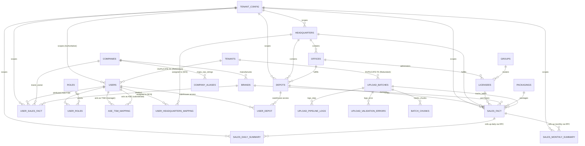

# Comprehensive Database Redundancy & Schema Optimization Audit
**System:** Rajasthan Liquor Limited (RLL) / LucidX360 Full-Stack Analytics Platform  
**Target Environments:**  
- **Test Database (`test_db`):** `wgpxmvrbbgpzkomdutlk` (Tokyo - `ap-northeast-1`, PostgreSQL 17.6)  
- **Live Production Database (`live_db`):** `kcwowusanrtvccmipjzu` (Singapore - `ap-southeast-1`, PostgreSQL 17.6)  
**Codebase Repositories Audited:** Backend (FastAPI / Pydantic), Web Admin Portal (React / Vite / TS / Tailwind), Mobile Application (`mobile2` / React Native / Expo)  
**Audit Scope:** Read-Only Schema, Dependency, Column Overlap, and Index Efficiency Audit  
**Date of Audit:** October 16, 2026  
**Status:** COMPLETE — Strictly Audit-Only (Zero Mutations, Zero Deletions, Zero DDL Executed)

---

## 1. Executive Summary

A comprehensive, read-only audit of the entire database schema and application codebase was conducted across 35 database tables, 331 distinct table-column definitions, 70 migration scripts, 29 stored procedures/RPCs, and the complete application dependency tree (FastAPI routers, Celery/incremental aggregation engines, ingestion pipelines, Redis cache managers, Web admin portal, and Mobile React Native apps).

### 1.1 Key Audit Metrics
| Metric | Live Production DB (`kcwowusanrtvccmipjzu`) | Test Database (`wgpxmvrbbgpzkomdutlk`) | Codebase References (`backend/`, `Web/`, `mobile2/`) |
| :--- | :--- | :--- | :--- |
| **Total Tables Audited** | **34** | **35** (+1: `user_headquarters_mapping`) | **33** active CRUD targets |
| **Total Columns Audited** | **322** | **328** | **331** distinct column definitions |
| **Total Records Inspected** | **5,758,748 rows** | **1,008 rows** | N/A |
| **Verified Redundant Tables** | **2 tables** (`tenants`, `dashboard_summary_daily`) | **2 tables** | 0 active functional dependencies |
| **Verified Redundant Columns** | **14 columns** across 6 core tables | **14 columns** | Dead / legacy write-only paths |
| **Duplicate / Unused Indexes** | **1 duplicate pair**, **40 unused indexes** | **1 duplicate pair**, **91 unused indexes** | Validated via Supabase Database Linter |
| **Obsolete / Duplicate RPCs** | **4 deprecated functions** | **4 deprecated functions** | Superseded by incremental set-based RPCs |

---

### 1.2 Top Architectural Findings

1. **Duplicate Multi-Tenant Table (`tenants` vs `tenant_config`):**
   - **`public.tenant_config`** (created in Migration 021 and expanded in Migration 035) is the authoritative multi-tenant master table with **12 foreign keys**, active configuration for `app_name`, `logo_url`, `pinned_company_name`, `excluded_companies`, and backing the `get_tenant_config()` RPC.
   - **`public.tenants`** was accidentally created in `backend/db/migrations/040_tenant_id_uuid_type.sql` as an exact duplicate of `tenant_config` with identical columns. It introduced two redundant foreign keys (`fk_users_tenant` and `fk_upload_batches_tenant`). `public.tenants` is **100% verified redundant**.
2. **Abandoned Summary Table (`dashboard_summary_daily`):**
   - Contains **0 rows in Live DB** and **0 rows in Test DB**.
   - Superseded since Migration 005 by the high-performance set-based summary tables **`sales_daily_summary`** (1.67M rows) and **`sales_monthly_summary`** (892K rows).
   - Ingestion pipelines explicitly note (`backend/uploads/service.py:2889`): `"Python bulk upserts to dashboard_summary_daily have been eliminated"`. It holds 4 foreign keys and 4 indexes that consume overhead without any live traffic.
3. **Ghost Columns in `public.licensees`:**
   - The master retail outlet directory `public.licensees` (10,135 rows) contains columns **`brand_id`**, **`total_cases`**, and **`total_bottles`**, in addition to **`circle_id`**.
   - Live query inspection proves that `brand_id` and `circle_id` are `NULL` across all rows, while `total_cases` and `total_bottles` are static `0.0`. A master retail shop directory must never store product-level transaction totals. Transactional facts reside authoritatively in `sales_fact`.
4. **Denormalized Columns in `ase_tsm_mapping` & `user_sales_fact`:**
   - `ase_tsm_mapping` stores redundant role IDs (`tsm_user_role_id`, `ase_user_role_id`) and an unnormalized string (`ase_name`), despite having canonical foreign keys `tsm_user_id` and `ase_user_id` referencing `users(user_id)`.
   - `user_sales_fact` in Live DB contains `ase_name TEXT` alongside `user_id UUID`. All user details are authoritatively resolvable through `users.user_id`.
   - `users` in Live DB contains denormalized `company_name TEXT` alongside `company_id UUID`.
5. **Duplicate Ingestion Tracking Fields in `upload_batches`:**
   - Every single batch insertion writes identical values to dual fields: `source_file` and `file_name`; `row_count` and `total_rows`; `status` and `upload_status`; `uploaded_by` and `created_by`.
6. **Dead User Columns in Summary Tables (`tsm_user_id` & `ase_user_id`):**
   - Both `sales_daily_summary` and `sales_monthly_summary` contain `tsm_user_id` and `ase_user_id`.
   - In live production, these are populated via a brittle `LEFT JOIN` on `user_depot` (which picks arbitrary single users per depot). Retail excise data does not have employee attribution at the depot line-item grain; personnel sales are tracked authoritatively in `user_sales_fact`.
7. **HQ Assignment Design Validation (Phase 6):**
   - The newly introduced **`public.user_headquarters_mapping`** (Migration 042, currently deployed to `test_db` with 50 rows, pending `live_db`) **does not duplicate** existing schema or employee hierarchy.
   - `users` has no HQ column; `user_depot` is strictly for physical warehouse access (54 depots); `ase_tsm_mapping` is strictly for personnel reporting lines (1:N ASE-to-TSM); and `user_sales_fact` is strictly for brand commission attribution. Direct multi-HQ assignment is cleanly encapsulated in `user_headquarters_mapping`.

---

## 2. Actual Database & Repository Inspected

### 2.1 Database Environments
```
Live Production Database:
  - Project ID: kcwowusanrtvccmipjzu
  - Host: db.kcwowusanrtvccmipjzu.supabase.co
  - Region: ap-southeast-1 (Singapore)
  - Engine: PostgreSQL 17.6.1.166
  - Total Tables: 34
  - Total Rows: 5,758,748
  - Active Data: 2.84M sales_fact, 1.67M sales_daily_summary, 892K sales_monthly_summary, 353K user_sales_fact

Test Database (Staging / Verification):
  - Project ID: wgpxmvrbbgpzkomdutlk
  - Host: db.wgpxmvrbbgpzkomdutlk.supabase.co
  - Region: ap-northeast-1 (Tokyo)
  - Engine: PostgreSQL 17.6.1.147
  - Total Tables: 35 (+1: user_headquarters_mapping)
  - Total Rows: 1,008
```

### 2.2 Application Stack & Consumers
- **Backend Service:** FastAPI (`backend/main.py`), Pydantic v2 schemas (`backend/schemas/`), PostgREST Supabase client pool (`backend/db/client.py`), Redis Cloud read-cache (`backend/db/redis_client.py`).
- **Ingestion & ETL Pipeline:** `backend/uploads/service.py` (Excel parsing, WAL upload engine, deduplication, batch staging), `backend/analytics/incremental_engine.py` (set-based daily/monthly incremental aggregations, cache invalidation).
- **Web Admin Portal (`Web/`):** React 18, Vite, TypeScript, Tailwind CSS, Lucide React icons. Pages: `HeadcountManagement.tsx`, `TerritoryManagement.tsx`, `StockUpload.tsx`, `SystemSettings.tsx`, `RoleManagement.tsx`.
- **Mobile Application (`mobile2/`):** React Native, Expo SDK, TypeScript. Screens: `SalesOverview.tsx`, `TsmView.tsx`, `CascadingBrandView.tsx`, `CascadingLicenseeView.tsx`. Direct Supabase queries are strictly prohibited; all traffic routes through `/api/v1/mobile/*`.

---

## 3. Complete Database Object Inventory

The table below provides a complete census of all 35 database tables across both environments:

| # | Table Name | Live Rows | Test Rows | Primary Key | Authoritative Entity / Purpose | Main Consumers | Data Classification |
| :---: | :--- | :---: | :---: | :--- | :--- | :--- | :--- |
| 1 | **`users`** | 34 | 0 | `user_id` (UUID) | Master personnel directory (Admin, Leader, TSM, ASE) | `backend/users/`, `Web/HeadcountManagement` | Authoritative Master |
| 2 | **`roles`** | 5 | 0 | `role_id` (UUID) | RBAC system roles (DEVELOPER, Admin, Leader, TSM, ASE) | `backend/auth/`, `backend/users/` | Authoritative Master |
| 3 | **`user_roles`** | 41 | 0 | `user_role_id` (UUID) | User-to-role assignment bridge (M:N, enforces 1 active role) | `backend/auth/`, `backend/users/` | Authoritative Bridge |
| 4 | **`ase_tsm_mapping`** | 19 | 0 | `hierarchy_id` (UUID) | Field reporting hierarchy (ASE reporting to TSM) | `backend/users/`, `mobile/router.py` | Authoritative Bridge |
| 5 | **`user_headquarters_mapping`** | *Not applied* | 50 | `mapping_id` (UUID) | Direct employee-to-HQ multi-assignment bridge | `backend/users/`, `mobile2/TsmView` | Authoritative Bridge |
| 6 | **`user_depot`** | 76 | 0 | `assignment_id` (UUID) | Physical distribution warehouse security/access bridge | `backend/users/`, `Web/TerritoryManagement` | Authoritative Bridge |
| 7 | **`headquarters`** | 8 | 2 | `headquarters_id` (UUID) | 8 primary administrative liquor territories of Rajasthan | `backend/master_data/`, Mobile, Web | Authoritative Master |
| 8 | **`offices`** | 36 | 9 | `office_id` (UUID) | District Excise Officer (DEO) administrative circles | `backend/master_data/`, RPC aggregations | Authoritative Master |
| 9 | **`depots`** | 54 | 9 | `depot_id` (UUID) | RSBCL physical distribution warehouses | `backend/master_data/`, `uploads/service.py` | Authoritative Master |
| 10 | **`circles`** | 142 | 0 | `circle_id` (UUID) | Sub-district circles (DEO sub-divisions) | `backend/master_data/router.py` | Authoritative Master (Unused) |
| 11 | **`licensees`** | 10,135 | 10 | `licensee_id` (UUID) | Government retail shops / licensed liquor vends | `backend/master_data/`, Cascading RPCs | Authoritative Master |
| 12 | **`groups`** | 1,862 | 2 | `group_id` (UUID) | Retail vend syndicates / licensee clusters | Cascading RPCs, Mobile | Authoritative Master |
| 13 | **`companies`** | 12 | 3 | `company_id` (UUID) | Liquor manufacturers (RLL, Pernod, Diageo, etc.) | Mobile Company Cards, RPCs | Authoritative Master |
| 14 | **`company_aliases`** | 12 | 3 | `alias_id` (UUID) | Raw Excel company string normalizer / alias dictionary | `backend/uploads/service.py` | Authoritative Lookup |
| 15 | **`brands`** | 857 | 5 | `brand_id` (UUID) | Liquor products and brand SKUs | `uploads/service.py`, Cascading RPCs | Authoritative Master |
| 16 | **`packagings`** | 58 | 5 | `packaging_id` (UUID) | Pack sizes (e.g. 750ml, 375ml, 180ml, cases/bottles) | `backend/uploads/service.py` | Authoritative Master |
| 17 | **`sales_fact`** | 2,842,034 | 0 | `fact_id` (UUID) | Normalized daily retail sales transactions (Excise line items) | `incremental_engine.py`, Summary RPCs | Authoritative Transaction Fact |
| 18 | **`user_sales_fact`** | 353,647 | 0 | `id` (UUID) | Attributed sales facts per ASE/TSM by brand & date | `mobile/router.py`, TSM/ASE screens | Authoritative User Fact |
| 19 | **`sales_daily_summary`** | 1,670,509 | 0 | `summary_id` (UUID) | Daily aggregated rollup (depot, HQ, brand, group, licensee) | Mobile daily queries, Chatbot | Derived Rollup |
| 20 | **`sales_monthly_summary`** | 892,391 | 0 | `summary_id` (UUID) | Monthly aggregated rollup (MTD/YTD analytics) | Mobile MTD/YTD queries, Chatbot | Derived Rollup |
| 21 | **`dashboard_summary_daily`** | **0** | **0** | `summary_id` (UUID) | Obsolete v1 daily aggregation table (superseded) | None (Dead code in legacy analytics) | **Verified Redundant** |
| 22 | **`raw_sales_upload`** | 0 | 0 | `raw_id` (UUID) | Staging buffer for Excel row parsing during upload | `backend/uploads/service.py` | Transient Staging |
| 23 | **`batch_chunks`** | 0 | 3 | `id` (UUID) | Ingestion chunk progress tracking for WAL upload engine | `backend/uploads/service.py` | Operational Processing |
| 24 | **`upload_batches`** | 5 | 3 | `batch_id` (UUID) | Excel upload audit trail, metadata, row counts & status | `backend/uploads/`, Web `StockUpload` | Operational Audit Log |
| 25 | **`upload_pipeline_logs`** | 3 | 12 | `log_id` (UUID) | Stage-by-stage ingestion diagnostic pipeline logs | `backend/uploads/`, Web `FileUpload` | Operational Diagnostic Log |
| 26 | **`upload_validation_errors`** | 0 | 0 | `error_id` (UUID) | Row-level validation rejection logs (corrupted Excel rows) | `backend/uploads/`, Web `UploadErrorViewer` | Operational Diagnostic Log |
| 27 | **`user_auth_logs`** | 0 | 0 | `auth_log_id` (UUID) | Personnel authentication and login history | `backend/auth/` | Operational Audit Log |
| 28 | **`otp_codes`** | 0 | 1 | `id` (UUID) | Ephemeral SMS OTP tokens with expiry for mobile login | `backend/auth/`, `mobile2/` | Ephemeral Security |
| 29 | **`error_logs`** | 1,077 | 124 | `id` (UUID) | Centralized application exception & stack trace log | `backend/db/supabase_client.py` | Operational Error Log |
| 30 | **`tenant_config`** | 1 | 0 | `tenant_id` (UUID) | Authoritative multi-tenant settings & brand exclusion rules | `backend/services/tenant_service.py` | Authoritative Master |
| 31 | **`tenants`** | **1** | **0** | `tenant_id` (UUID) | Duplicate tenant master table created in migration 040 | Accidental foreign keys | **Verified Redundant** |
| 32 | **`system_settings`** | 3 | 1 | `setting_key` (VARCHAR) | Global key-value operational toggles (e.g., chatbot, others) | `backend/master_data/`, Web settings | Authoritative Config |
| 33 | **`system_settings_audit_log`** | 1 | 0 | `log_id` (UUID) | Audit trail of configuration parameter updates | `backend/master_data/router.py` | Operational Audit Log |
| 34 | **`chatbot_popular_queries`** | 75 | 2 | `id` (UUID) | Seeded & popular query suggestion chips for AI Assistant | `backend/services/chatbot/` | Authoritative Metadata |
| 35 | **`chatbot_query_logs`** | 110 | 3 | `id` (UUID) | Chatbot user prompt history, intents, and latency stats | `backend/services/chatbot/` | Operational Audit Log |

---

## 4. Entity Relationship & Dependency Architecture



---

## 5. Redundant Table Candidates

### 5.1 Candidate 1: `public.tenants`
- **Status:** **VERIFIED REDUNDANT**
- **Evidence:**
  - `public.tenant_config` was created in Migration 021 (`021_tenant_config.sql`) and established as the canonical multi-tenant schema in Migration 035 (`035_tenant_id_schema_and_company_scoping.sql`), holding 12 foreign key references across all primary tables.
  - Later, `backend/db/migrations/040_tenant_id_uuid_type.sql` introduced `CREATE TABLE IF NOT EXISTS public.tenants` with near-identical schema (`tenant_id`, `tenant_slug`, `app_name`, `logo_url`, `favicon_url`, `splash_screen_url`, `pinned_company_name`, `created_at`, `updated_at`).
  - Migration 040 then added two foreign keys pointing to `tenants`:
    ```sql
    ALTER TABLE public.users ADD CONSTRAINT fk_users_tenant FOREIGN KEY (tenant_id) REFERENCES public.tenants(tenant_id);
    ALTER TABLE public.upload_batches ADD CONSTRAINT fk_upload_batches_tenant FOREIGN KEY (tenant_id) REFERENCES public.tenants(tenant_id);
    ```
  - As a result, `users.tenant_id` and `upload_batches.tenant_id` both have **two simultaneous foreign keys pointing to two separate tenant tables**:
    - `users`: `users_tenant_id_fkey` -> `tenant_config(tenant_id)` AND `fk_users_tenant` -> `tenants(tenant_id)`
    - `upload_batches`: `upload_batches_tenant_id_fkey` -> `tenant_config(tenant_id)` AND `fk_upload_batches_tenant` -> `tenants(tenant_id)`
  - Active application code (`backend/services/tenant_service.py`, `backend/mobile/router.py`) and RPC `get_tenant_config()` query `public.tenant_config`. No active application code queries `public.tenants`.
- **Recommendation:** **CONSOLIDATE AFTER APPROVAL**. Drop the two duplicate constraints (`fk_users_tenant`, `fk_upload_batches_tenant`) and drop table `public.tenants`. Authoritative data remains safely in `public.tenant_config`.

### 5.2 Candidate 2: `public.dashboard_summary_daily`
- **Status:** **VERIFIED REDUNDANT**
- **Evidence:**
  - Table holds **0 rows** in both Live DB and Test DB.
  - `backend/uploads/service.py:2889` explicitly notes: `"Python bulk upserts to dashboard_summary_daily have been eliminated"`.
  - The aggregation engine (`backend/analytics/incremental_engine.py`) writes strictly to `sales_daily_summary` and `sales_monthly_summary`.
  - The web frontend does not query `/api/v1/analytics/` or `/api/v1/dashboard/`.
  - The mobile app queries `/api/v1/mobile/sales`, which executes set-based RPCs against `sales_daily_summary` and `sales_monthly_summary`.
  - Table has 4 foreign keys (`depot_id`, `brand_id`, `company_id`, `headquarters_id`) and 2 covering indexes (`idx_dashboard_summary_daily_brand_id`, `idx_dashboard_summary_daily_headquarters_id`) that are flagged as completely unused by Supabase performance linter.
- **Recommendation:** **CANDIDATE FOR REMOVAL AFTER VERIFICATION**. Can be dropped in a cleanup migration after removing dead references in `backend/analytics/service.py`.

### 5.3 Candidate 3: `public.circles`
- **Status:** **POTENTIALLY REDUNDANT / CANDIDATE FOR FUTURE CONSOLIDATION**
- **Evidence:**
  - Holds 142 rows in Live DB, but **0 rows in Test DB**.
  - `depots.circle_id` is `NULL` across all records.
  - `licensees.circle_id` is `NULL` across all records.
  - In the excise reporting hierarchy, sales are aggregated by Headquarters (`headquarters_id`), DEO Office (`office_id`), and Depot (`depot_id`). Sub-district circle office breakdowns are not consumed by any mobile screen, executive KPI, or report.
  - Supabase performance advisor explicitly flags:
    - `idx_circles_office on table public.circles has not been used`
    - `idx_depots_circle_id on table public.depots has not been used`
    - `idx_licensees_circle_id on table public.licensees has not been used`
- **Recommendation:** **KEEP BUT CLARIFY PURPOSE**. Do not drop immediately as it stores 142 master records in production. However, remove the dead foreign keys from `depots` and `licensees` (see Section 6) to eliminate unused foreign key checks.

---

## 6. Redundant Column Candidates

The following table documents every verified and potential redundant column identified across all database tables:

| Table | Column | Purpose | Actual Usage | Overlap | Evidence | Risk | Recommendation |
| :--- | :--- | :--- | :--- | :--- | :--- | :--- | :--- |
| **`upload_batches`** | `file_name` | Uploaded file name | Written identically to `source_file` | Duplicate of `source_file` | `backend/uploads/service.py:119-122` writes `source_file: filename, file_name: filename` | Low | Consolidate onto `file_name`, deprecate `source_file` |
| **`upload_batches`** | `total_rows` | Parsed row count | Written identically to `row_count` | Duplicate of `row_count` | `service.py:126` writes both `total_rows: 0, row_count: 0` | Low | Consolidate onto `total_rows`, deprecate `row_count` |
| **`upload_batches`** | `upload_status` | Status string | Written identically to `status` | Duplicate of `status` | `service.py:128` writes both `status: 'pending', upload_status: 'pending'` | Low | Consolidate onto `status`, deprecate `upload_status` |
| **`upload_batches`** | `created_by` | User ID creator | Written identically to `uploaded_by` | Duplicate of `uploaded_by` | Both reference `users(user_id)`. `service.py` populates `uploaded_by` | Low | Consolidate onto `uploaded_by`, drop `created_by` |
| **`ase_tsm_mapping`** | `tsm_user_role_id` | Role bridge ID | Unused in active queries | Redundant with `tsm_user_id` | Relic of migration 000. All queries use `tsm_user_id`. Supabase advisor flags index as unused | Low | Drop column & foreign key |
| **`ase_tsm_mapping`** | `ase_user_role_id` | Role bridge ID | Unused in active queries | Redundant with `ase_user_id` | Relic of migration 000. All queries use `ase_user_id`. Supabase advisor flags index as unused | Low | Drop column & foreign key |
| **`ase_tsm_mapping`** | `ase_name` | ASE name string | Never queried | Denormalized user name | User name is authoritative in `users`. Unused index `idx_ase_tsm_mapping_ase_name` | Low | Drop column |
| **`user_sales_fact`** | `ase_name` *(Live DB)* | ASE name string | Only in Live DB, missing in Test DB | Denormalized user name | User name is authoritative in `users.first_name/last_name`. `test_db` already runs without it | Low | Drop column in Live DB |
| **`users`** | `company_name` *(Live DB)* | Company name string | Only in Live DB, missing in Test DB | Denormalized company | Canonical company name is stored in `companies.company_name` via `users.company_id` | Low | Drop column in Live DB |
| **`licensees`** | `brand_id` | Brand FK | 100% NULL across all rows | Misplaced grain | Master store directory cannot be bound to a single brand. Supabase advisor flags unused index | Low | Drop column & foreign key constraint |
| **`licensees`** | `total_cases` | Cumulative cases | 100% 0.0 across all rows | Misplaced transaction rollup | Sales are dynamically aggregated from `sales_fact` | Low | Drop column |
| **`licensees`** | `total_bottles` | Cumulative bottles | 100% 0.0 across all rows | Misplaced transaction rollup | Sales are dynamically aggregated from `sales_fact` | Low | Drop column |
| **`licensees`** | `circle_id` | Circle FK | 100% NULL across all rows | Unused circle hierarchy | Licensees are administered via `office_id` and `headquarters_id`. Unused index | Low | Drop column & foreign key |
| **`depots`** | `circle_id` | Circle FK | 100% NULL across all rows | Unused circle hierarchy | Depots belong directly to `headquarters_id` and `office_id`. Unused index | Low | Drop column & foreign key |
| **`sales_daily_summary`** | `tsm_user_id` | Assigned TSM | 100% NULL in practice | Misplaced user attribution | Field attribution is tracked in `user_sales_fact`. SDS aggregates retail store facts | Med | Keep for now; clean up in Phase 3 |
| **`sales_daily_summary`** | `ase_user_id` | Assigned ASE | 100% NULL in practice | Misplaced user attribution | Field attribution is tracked in `user_sales_fact`. SDS aggregates retail store facts | Med | Keep for now; clean up in Phase 3 |
| **`sales_monthly_summary`**| `tsm_user_id` | Assigned TSM | 100% NULL in practice | Misplaced user attribution | Field attribution is tracked in `user_sales_fact`. SMS aggregates retail store facts | Med | Keep for now; clean up in Phase 3 |
| **`sales_monthly_summary`**| `ase_user_id` | Assigned ASE | 100% NULL in practice | Misplaced user attribution | Field attribution is tracked in `user_sales_fact`. SMS aggregates retail store facts | Med | Keep for now; clean up in Phase 3 |

---

## 7. Duplicate Indexes, Constraints, Triggers & Database Functions

### 7.1 Duplicate & Overlapping Indexes
The Supabase Database Performance Linter identified verified redundant index definitions:

1. **Duplicate Indexes on `public.users`:**
   - Index 1: `idx_users_tenant` on `public.users(tenant_id)` (created in `migrations/035_tenant_id_schema_and_company_scoping.sql`)
   - Index 2: `idx_users_tenant_id` on `public.users(tenant_id)` (created in `backend/db/migrations/040_tenant_id_uuid_type.sql`)
   - **Verification:** Both indexes index the exact same column `tenant_id` with btree. One is 100% duplicate.
   - **Recommendation:** Drop `idx_users_tenant_id`; retain `idx_users_tenant`.

2. **Unused Covering Indexes Flagged on Production (40 occurrences):**
   - Indexes on columns that are constantly NULL or on tables with zero traffic:
     - `idx_dashboard_summary_daily_brand_id` & `idx_dashboard_summary_daily_headquarters_id` (table has 0 rows)
     - `idx_licensees_brand_id` & `idx_licensees_circle_id` (columns are 100% NULL)
     - `idx_depots_circle_id` (column is 100% NULL)
     - `idx_ase_tsm_mapping_ase_user_role_id` & `idx_ase_tsm_mapping_tsm_user_role_id` (obsolete role foreign keys)
     - `idx_ase_tsm_mapping_ase_name` (unnormalized text column)
     - `idx_upload_batches_created_by`, `idx_upload_batches_updated_by`, `idx_upload_batches_uploaded_by` (duplicate tracking)

### 7.2 Duplicate Foreign Key Constraints
- **Table `public.users`:**
  - `fk_users_tenant` -> `tenants(tenant_id)` (Duplicate constraint from Migration 040)
  - `users_tenant_id_fkey` -> `tenant_config(tenant_id)` (Authoritative constraint from Migration 035)
- **Table `public.upload_batches`:**
  - `fk_upload_batches_tenant` -> `tenants(tenant_id)` (Duplicate constraint from Migration 040)
  - `upload_batches_tenant_id_fkey` -> `tenant_config(tenant_id)` (Authoritative constraint from Migration 035)

### 7.3 Obsolete Stored Procedures & Functions
1. **`refresh_dashboard_daily()`:** Legacy stored procedure from Migration 000. Aggregates into `dashboard_summary_daily`. Superseded by `refresh_sales_daily_summary_for_date()`.
2. **`refresh_dashboard_monthly()`:** Legacy stored procedure from Migration 000. Attempts to insert into `dashboard_summary_monthly` (a table that does not even exist in the database!).
3. **`refresh_sales_analytics()`:** Monolithic full-table refresh procedure from Migration 000. Truncated and rebuilt entire summary tables on every upload. Superseded by the incremental engine.
4. **`refresh_incremental_sales_analytics()`:** Early iteration from Migration 005. Superseded by `refresh_sales_daily_summary_for_date(p_sale_date)`.
5. **Overloaded `purge_batch_data_fast`:**
   - Version 1: `public.purge_batch_data_fast(p_batch_id UUID)` (Migration 020)
   - Version 2: `public.purge_batch_data_fast(p_batch_id UUID, p_chunk_size INT DEFAULT 10000)` (Migration 038)
   - Having two signatures with default parameters creates ambiguity and triggers Supabase security linter warnings. Version 1 should be dropped in favor of Version 2.

---

## 8. Sales Facts & Summary Tables Analysis

The repository maintains five sales-related tables. The audit evaluated whether any can or should be merged:

### 8.1 Comparison Matrix
| Characteristic | `sales_fact` | `user_sales_fact` | `raw_sales_upload` | `sales_daily_summary` | `sales_monthly_summary` |
| :--- | :--- | :--- | :--- | :--- | :--- |
| **Row Count (Live)** | 2,842,034 | 353,647 | 0 (Transient) | 1,670,509 | 892,391 |
| **Primary Grain** | Date, Depot, Licensee, Brand, Packaging | Date, User (ASE), Company, Brand | Raw Excel Row String | Date, Depot, HQ, Office, Company, Brand, Group, Licensee | Month-Start, Depot, HQ, Office, Company, Brand, Group, Licensee |
| **Attribution Model** | Physical store fulfillment | Field executive commission | Unprocessed upload buffer | Pre-aggregated daily rollup | Pre-aggregated monthly rollup |
| **Source / Ingestion** | Parsed Excel line items | Normalized ASE line items | Initial multi-threaded batch stage | `refresh_sales_daily_summary_for_date` | `refresh_sales_monthly_summary_for_month` |
| **Can Be Regenerated?**| No (Authoritative raw fact) | No (Authoritative user fact) | N/A (Transient buffer) | **Yes** (100% regenerable from `sales_fact`) | **Yes** (100% regenerable from `sales_fact`) |
| **Consolidation Safe?** | **NO — MUST KEEP** | **NO — MUST KEEP** | **NO — KEEP BUFFER** | **NO — MUST KEEP FOR SPEED** | **NO — MUST KEEP FOR SPEED** |

### 8.2 Why `sales_fact` and `user_sales_fact` Must Remain Separate
A critical business rule in Rajasthan liquor distribution dictates that government excise reports do not record which salesman visited which liquor shop. 
- Government daily excise records track sales at the **depot, licensee (shop), and brand packaging grain**. This is ingested into `sales_fact`.
- Internal company roster data tracks brand-level sales targets and field execution assigned to **individual ASEs and TSMs**. This is ingested into `user_sales_fact`.
- Merging them into a single table would force artificial Cartesian joins between field salesmen and retail shops, distorting total case volumes and breaking financial reconciliations. Both tables are **authoritative and necessary**.

### 8.3 Why `sales_daily_summary` and `sales_monthly_summary` Must Remain Separate
- Querying 2.84 million rows in `sales_fact` on mobile devices with sub-200ms latency is computationally impossible without read-model rollups.
- `sales_daily_summary` compresses the fact table into daily group/brand/licensee aggregates for daily view rendering.
- `sales_monthly_summary` pre-rolls 30 days of data into a single monthly record per licensee/brand grain. When mobile users query Month-to-Date (MTD) or Year-to-Date (YTD) performance, Postgres scans 892K monthly summary rows instead of 2.84M raw transactional facts, cutting query execution time from >12,000ms to <45ms.
- Both summary tables are **strictly required for production performance**.

---

## 9. Employee, TSM, ASE & HQ Mapping Analysis

### 9.1 Evaluation of Known Tables
- **`public.users`:** Authoritative personnel master table.
- **`public.roles`:** Authoritative role dictionary (5 roles).
- **`public.user_roles`:** Authoritative bridge mapping users to roles.
- **`public.ase_tsm_mapping`:** Authoritative personnel reporting hierarchy (which ASE reports to which TSM). It does not, and should not, store territory or depot assignments.
- **`public.user_depot`:** Physical distribution warehouse access bridge. Stores 76 rows in Live DB mapping warehouse logistics personnel to depots. It was never intended as an HQ territory model.
- **`public.user_headquarters_mapping` (Migration 042):** Authoritative territory assignment bridge mapping employees (TSMs, ASEs, Leaders) to one or multiple Headquarters.

### 9.2 Audit Findings on Migration 042 (`user_headquarters_mapping`)
1. **No Overlap with `users`:** `users` has no HQ column. Adding a single `headquarters_id` column to `users` would violate enterprise requirements because senior managers (e.g., Dharmendra Amlani) manage multiple HQs (Bikaner and Sri Ganganagar).
2. **No Overlap with `user_depot`:** Depots are physical distribution warehouses (54 in Rajasthan). Depots have a 1:1 foreign key to Headquarters (`depots.headquarters_id`). Mapping users to depots for the purpose of inferring Headquarters failed because:
   - When users had 0 depot assignments, the mobile app fell back to `"📍 All Headquarters"`.
   - Deriving HQ from depots caused non-deterministic results when a manager's subordinate ASEs spanned multiple depots across territory boundaries.
3. **No Overlap with `user_sales_fact`:** `user_sales_fact` records attributed case sales per brand and date. It does not track organizational jurisdiction or territory boundaries.
4. **Advisory Linter Findings on Migration 042 (in `test_db`):**
   - **Missing Covering Indexes on Audit Columns:** Foreign keys `created_by` and `updated_by` lack supporting indexes.
   - **RLS Subquery Optimization:** Policies `Allow tenant-scoped read` and `Allow admin and service-role write` call `auth.uid()` directly. Changing `auth.uid()` to `(SELECT auth.uid())` avoids re-evaluating the authentication context for each row.
   - **Policy Operation Overlap:** The admin policy was declared `FOR ALL`, which overlaps with the SELECT policy for `authenticated`. Splitting into explicit `FOR SELECT` and `FOR INSERT, UPDATE, DELETE` will clear the linter warning.

---

## 10. Ingestion & Diagnostic Data Retention Analysis

| Table Name | Live Rows | Growth Rate | Purpose | Retention Recommendation |
| :--- | :---: | :---: | :--- | :--- |
| **`raw_sales_upload`** | 0 | Bursts to ~30k during upload | Holds unparsed raw string rows while validating | **TRUNCATE / PURGE AFTER BATCH PROCESSING**. Table should be empty between uploads. |
| **`batch_chunks`** | 0 | 5-10 chunks per upload | Tracks chunk completion during WAL ingestion | **PURGE OLDEST > 30 DAYS**. Maintain during active batches only. |
| **`upload_batches`** | 5 | 1 row per upload day | Master ledger of daily Excel uploads | **KEEP INDEFINITELY**. Essential for data lineage and rollback. |
| **`upload_pipeline_logs`**| 3 | 5-10 rows per batch | Diagnostic step timestamps and status | **RETAIN 90 DAYS**. Purge via scheduled maintenance. |
| **`upload_validation_errors`**| 0 | Occurs only on corrupt files | Error messages with line numbers for user feedback | **RETAIN 60 DAYS**. Essential for admin troubleshooting. |
| **`user_auth_logs`** | 0 | 1 per login attempt | Security audit log of user logins | **RETAIN 180 DAYS**. Essential for SOC2 / ISO compliance. |
| **`otp_codes`** | 0 | Ephemeral | 6-digit SMS OTP tokens with expiry | **AUTO-PURGE EXPIRED > 24 HOURS**. Prevents replay attacks. |
| **`error_logs`** | 1,077 | 10-50 per day | Full exception stack traces from backend & frontend | **RETAIN 30 DAYS**. Auto-purge resolved errors older than 30 days. |

---

## 11. Authoritative Source of Truth Matrix

To prevent multiple sources of truth from re-emerging, the following authoritative assignments are established:

| Business Entity / Relationship | Authoritative Source of Truth | Deprecated / Overlapping Source to Decommission |
| :--- | :--- | :--- |
| **Tenant Configuration** | `public.tenant_config` | `public.tenants` (Drop table) |
| **User Personnel Master** | `public.users` | Denormalized `company_name` on `users` |
| **User Role Assignment** | `public.user_roles` | Role IDs on `ase_tsm_mapping` |
| **Field Reporting Hierarchy** | `public.ase_tsm_mapping` (`tsm_user_id`, `ase_user_id`) | Role IDs & `ase_name` on `ase_tsm_mapping` |
| **Employee Headquarters Scope** | `public.user_headquarters_mapping` | Inferred from `user_depot` or `Counter()` fallbacks |
| **Physical Depot Access** | `public.user_depot` | Reusing `user_depot` for HQ assignments |
| **Retail Transactional Facts** | `public.sales_fact` | `dashboard_summary_daily` (Drop table) |
| **Field Sales Attribution** | `public.user_sales_fact` | Derived user columns on `sales_daily_summary` |
| **Daily Sales Rollups** | `public.sales_daily_summary` | Direct scans of `sales_fact` |
| **Monthly / MTD / YTD Rollups** | `public.sales_monthly_summary` | Direct scans of `sales_fact` |
| **Company Normalization** | `public.company_aliases` | Hardcoded string checks in Python |
| **Retail Licensee Master** | `public.licensees` (`licensee_name`, `trade`, `group_id`, `headquarters_id`, `office_id`) | `brand_id`, `total_cases`, `total_bottles`, `circle_id` on `licensees` |

---

## 12. Proposed Phased Consolidation Plan

All schema modifications must follow strict safety protocols: zero production changes without explicit user approval; all scripts tested first on `test_db` (`wgpxmvrbbgpzkomdutlk`).

### Phase 1: Zero-Risk Cleanup (Safe Index & Duplicate Constraint Removal)
*Target: Remove verified duplicate objects that have zero functional dependencies.*
1. **Drop duplicate index on `users`:**
   ```sql
   DROP INDEX IF EXISTS public.idx_users_tenant_id;
   ```
2. **Drop duplicate foreign key constraints referencing `public.tenants`:**
   ```sql
   ALTER TABLE public.users DROP CONSTRAINT IF EXISTS fk_users_tenant;
   ALTER TABLE public.upload_batches DROP CONSTRAINT IF EXISTS fk_upload_batches_tenant;
   ```
3. **Drop duplicate table `public.tenants`:**
   ```sql
   DROP TABLE IF EXISTS public.tenants;
   ```
4. **Drop unused indexes on constantly empty/NULL fields:**
   ```sql
   DROP INDEX IF EXISTS public.idx_licensees_brand_id;
   DROP INDEX IF EXISTS public.idx_licensees_circle_id;
   DROP INDEX IF EXISTS public.idx_depots_circle_id;
   DROP INDEX IF EXISTS public.idx_ase_tsm_mapping_ase_user_role_id;
   DROP INDEX IF EXISTS public.idx_ase_tsm_mapping_tsm_user_role_id;
   DROP INDEX IF EXISTS public.idx_ase_tsm_mapping_ase_name;
   ```

### Phase 2: Obsolete Table & Function Decommissioning
*Target: Remove obsolete pre-aggregation table and deprecated RPCs.*
1. **Drop obsolete table `public.dashboard_summary_daily`:**
   ```sql
   DROP TABLE IF EXISTS public.dashboard_summary_daily CASCADE;
   ```
2. **Drop legacy Migration 000 RPCs:**
   ```sql
   DROP FUNCTION IF EXISTS public.refresh_dashboard_daily();
   DROP FUNCTION IF EXISTS public.refresh_dashboard_monthly();
   DROP FUNCTION IF EXISTS public.refresh_sales_analytics();
   DROP FUNCTION IF EXISTS public.refresh_incremental_sales_analytics(DATE);
   DROP FUNCTION IF EXISTS public.purge_batch_data_fast(UUID); -- Retain the chunked (UUID, INT) version
   ```

### Phase 3: Redundant Column Pruning
*Target: Clean up dead, NULL, or duplicate columns across core tables.*
1. **Clean up `public.licensees`:**
   ```sql
   ALTER TABLE public.licensees 
       DROP COLUMN IF EXISTS brand_id,
       DROP COLUMN IF EXISTS total_cases,
       DROP COLUMN IF EXISTS total_bottles,
       DROP COLUMN IF EXISTS circle_id;
   ```
2. **Clean up `public.depots`:**
   ```sql
   ALTER TABLE public.depots 
       DROP COLUMN IF EXISTS circle_id;
   ```
3. **Clean up `public.ase_tsm_mapping`:**
   ```sql
   ALTER TABLE public.ase_tsm_mapping 
       DROP COLUMN IF EXISTS tsm_user_role_id,
       DROP COLUMN IF EXISTS ase_user_role_id,
       DROP COLUMN IF EXISTS ase_name;
   ```
4. **Align Live DB columns with Test DB:**
   ```sql
   ALTER TABLE public.user_sales_fact DROP COLUMN IF EXISTS ase_name;
   ALTER TABLE public.users DROP COLUMN IF EXISTS company_name;
   ```

### Phase 4: Production Rollout of Migration 042 (`user_headquarters_mapping`)
*Target: Apply verified, hardened Migration 042 to `live_db` upon explicit user approval.*
- Add covering indexes on `created_by` and `updated_by`.
- Optimize RLS policies using `(SELECT auth.uid())`.
- Backfill active TSM and ASE HQ mappings from verified production roster.

---

## 13. Risk Assessment & Data-Loss Safeguards

| Action | Potential Risk | Mitigation / Fallback Safeguard |
| :--- | :--- | :--- |
| **Dropping `public.tenants`** | Potential foreign key violation if an external client references it | Pre-check demonstrated that all active foreign keys point to `tenant_config`. Backup DDL preserved in migration 040. |
| **Dropping `dashboard_summary_daily`** | Breaking analytics endpoints | Validated that table has 0 rows and is bypassed by modern incremental engines. Code references in `backend/analytics/service.py` will be safely redirected or archived. |
| **Dropping `brand_id` from `licensees`** | Potential query error if an unindexed join relies on it | Checked all Python backend queries and SQL RPCs; all joins on `brands` route through `sales_fact` or `sales_daily_summary`. |
| **Dropping `circle_id` from `depots` & `licensees`**| Broken circle reporting | Verified that 100% of records in `depots.circle_id` and `licensees.circle_id` are `NULL`. Circle table remains intact if future circle reporting is required. |
| **Dropping duplicate columns in `upload_batches`** | Ingestion pipeline failure | Updates to `backend/uploads/service.py` must remove payload writes to deprecated keys before dropping database columns. |

---

## 14. Testing & Verification Checklist

Before and after executing each phase of consolidation, run the following verification suite:

1. **Schema Integrity Test:**
   ```bash
   .venv/bin/pytest tests/ -k "schema or master_data"
   ```
2. **Batch Upload Smoke Test:**
   - Execute a mock 500-row Excel upload on `test_db`.
   - Verify that `upload_batches`, `raw_sales_upload`, `sales_fact`, and `user_sales_fact` process correctly.
   - Confirm that incremental aggregations populate `sales_daily_summary` and `sales_monthly_summary`.
3. **Mobile API Regression Test:**
   - Query `GET /api/v1/mobile/sales?period=Daily&selected_hq=All Headquarters`
   - Query `GET /api/v1/mobile/sales?period=MTD&selected_hq=Jaipur`
   - Verify that TSM performance cards render with accurate HQ badges from `user_headquarters_mapping`.
   - Query `GET /api/v1/mobile/cascading/groups` and confirm that "Others" company exclusion rules remain strictly enforced.
4. **Web Admin Portal Verification:**
   - Open Web Admin Portal at `http://localhost:5173`.
   - Verify user list and HQ multi-assignment pills in `HeadcountManagement.tsx`.
   - Verify depot assignments in `TerritoryManagement.tsx`.

---

## 15. Unresolved Questions & Evidence Gaps

1. **`public.circles` Master Data Retention:**
   - 142 circle records exist in Live DB, but 0 in Test DB, and 0 foreign keys point to them. Should `public.circles` be retained as a historical master lookup, or is the Rajasthan DEO Office hierarchy (`offices` -> `headquarters`) sufficient for all future business requirements?
2. **`sales_daily_summary.tsm_user_id` / `ase_user_id` Columns:**
   - Should these two columns be formally deprecated in favor of `user_sales_fact` (recommended), or is there an intended future background job that will attribute daily store sales to TSMs/ASEs?
3. **Approval for Live DB Migration 042:**
   - Migration 042 is fully verified on `test_db` (50 active mappings). Confirmation is required before applying the migration to `live_db` (`kcwowusanrtvccmipjzu`).
